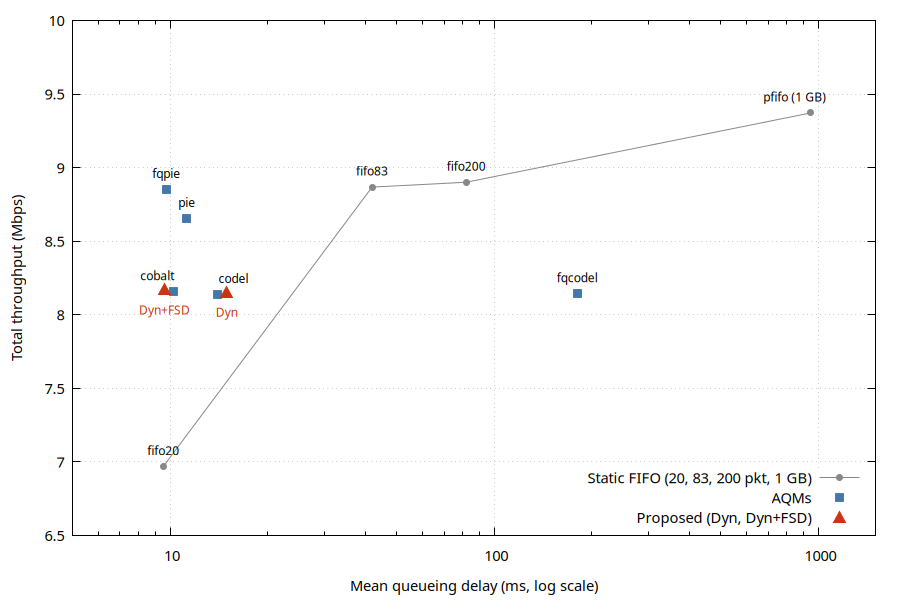

# Results

Dynamic FIFO buffer management (Dyn) and fair-share drop (FSD) for 5G NR mixed traffic, compared with the six AQMs from the base paper and with static FIFO sizes. All numbers are the mean of 3 seeds (1-3), 300 s each, unless stated otherwise.

Base paper: Naik et al., "Study of 5G NR Network Against Mixed Traffic", COMSNETS 2025.

## 1. Setup

| Item | Value |
|---|---|
| Simulator | ns-3.48 + 5G-LENA (`nr`, branch `5g-lena-v5.0.y`), optimized build |
| Topology | 7 hosts, 100 Mbps / 5 ms, router, 10 Mbps / 40 ms bottleneck, PGW, gNB, 7 UEs. The qdisc sits on the router egress (plain IP, before GTP) |
| Radio | 28 GHz, 50 MHz, numerology 4, 35 dBm, UMi, direct-path beamforming |
| Traffic (7 flows) | UDP burst (OnOff, 50 s off / 50 s on, 10 Mbps), TCP bulk, FTP, HTTP, VoIP, gaming, UDP video. DASH is omitted |
| Baseline buffer | qdisc MaxSize 666666 packets (about 1 GB); device queue 1 packet; RLC never drops |
| Runs | 300 s, seeds 1-3, TCP CUBIC, default AQM parameters |
| Metrics | Qdisc sojourn time (1 s bins), drops per second, per-flow goodput, mean delay, total throughput, Jain index over 7 flows, J2 = Jain(UDP burst, TCP bulk) inside UDP-ON windows |

UDP-ON windows: 50-100 s, 150-200 s, 250-300 s.

Assumptions the paper does not specify:

- **D4/D5**: delay means qdisc sojourn time only.
- **D6**: default AQM parameters.
- **D7**: DASH omitted (not in ns-3 mainline).
- **D8**: UDP burst rate 10 Mbps.
- **D13**: validation is by trend and ranking, not by exact values.

## 2. Proposed method

- **Dyn**: every T = 100 ms take m = max sojourn time. A period is bad if m > 25 ms. After H = 3 bad periods the limit is halved (minimum 20). If m < 12.5 ms the limit grows by 5 (maximum 200). Start at 83 packets (BDP). The limit is applied with `SetMaxSize(max(limit, occupancy))`.
- **Dyn + FSD**: `FsdQueueDisc` is a `FifoQueueDisc` subclass with a soft limit from Dyn. Above the soft limit an arrival is dropped if its flow already holds at least `floor(limit / activeFlows)` packets, or if the queue has reached 2 x limit (hard cap 400 packets). `activeFlows` counts flows with a packet in the queue, including the arriving flow. The limit is applied with `SetLimit(limit)`.
- **H tuning** (60 s, seed 1): H=1 gives 29.9 ms / 6.22 Mbps, H=2 gives 25.5 ms / 6.30 Mbps, H=3 gives 35.8 ms / 6.60 Mbps. H=3 has the highest throughput of the three and is kept.
- **Rejected ablation**: longest-flow drop rule (`--longest`, tag `fsdl`). Seeds 1-2 are close to FSD (drops +24% / +31%). In seed 3 TCP bulk is starved (0.008 Mbps).

## 3. Reproduction: paper vs this work

| AQM | Paper delay (ms) | Our delay (ms) | Ours / paper | Paper rank | Our rank | Paper thr (Mbps) | Our thr (Mbps) | Delta thr | Figure similarity |
|---|---|---|---|---|---|---|---|---|---|
| PFIFO Fast | 254.42 | 946.78 | 3.72x | 6 | 6 | 9.068 | 9.372 | +3.4% | ~45% |
| CoDel | 153.21 | 14.00 | 0.09x | 5 | 4 | 9.067 | 8.138 | -10.2% | ~60% |
| PIE | 67.16 | 11.25 | 0.17x | 2 | 3 | 8.983 | 8.655 | -3.7% | ~85% |
| COBALT | 80.00 | 10.22 | 0.13x | 3 | 2 | 6.532 | 8.157 | +24.9% | ~75% |
| FQ-CoDel | 132.44 | 180.18 | 1.36x | 4 | 5 | 8.893 | 8.144 | -8.4% | ~90% |
| FQ-PIE | 58.17 | 9.74 | 0.17x | 1 | 1 | 8.718 | 8.851 | +1.5% | ~80% |

Best (FQ-PIE) and worst (PFIFO) match the paper. Throughput is within 10% for 4 of 6 AQMs (CoDel -10.2% and COBALT +24.9% are outside). Overall figure similarity is about 72%. Similarity is a per-panel comparison of paper Figs 3 and 5-9 against the paper-style figures here (seed 1, 1 s bins).

1 s peak delay, seed 1 (ms): PFIFO 5054, CoDel 314, PIE 127, COBALT 290, FQ-CoDel 1004, FQ-PIE 132, Dyn 176, Dyn + FSD 72. The paper peaks are about 470, 1050, 28, 420, 950, 260.

## 4. All configurations

| Group | Config | Mean delay (ms) | Thr (Mbps) | Jain (7) | UDP ON (Mbps) | TCP bulk ON (Mbps) | J2 ON | Mean drops |
|---|---|---|---|---|---|---|---|---|
| Baseline 1 GB | PFIFO Fast | 946.78 | 9.372 | 0.294 | 9.12 | 0.52 | 0.556 | 0 |
| AQM | CoDel | 14.00 | 8.138 | 0.288 | 9.41 | 0.24 | 0.525 | 9038 |
| AQM | PIE | 11.25 | 8.655 | 0.295 | 9.45 | 0.21 | 0.522 | 8752 |
| AQM | COBALT | 10.22 | 8.157 | 0.290 | 9.48 | 0.19 | 0.520 | 8537 |
| AQM (FQ) | FQ-CoDel | 180.18 | 8.144 | 0.278 | 5.87 | 3.50 | 0.940 | 54715 |
| AQM (FQ) | FQ-PIE | 9.74 | 8.851 | 0.261 | 5.48 | 3.86 | 0.971 | 60277 |
| Static FIFO | FIFO-20 | 9.52 | 6.968 | 0.253 | 9.67 | 0.04 | 0.504 | 8915 |
| Static FIFO | FIFO-83 (BDP) | 41.99 | 8.868 | 0.292 | 9.66 | 0.05 | 0.505 | 8205 |
| Static FIFO | FIFO-200 | 81.95 | 8.901 | 0.291 | 9.65 | 0.06 | 0.506 | 7682 |
| Proposed | Dyn | 14.95 | 8.153 | 0.284 | 9.64 | 0.06 | 0.507 | 9856 |
| Proposed | Dyn + FSD | 9.61 | 8.169 | 0.288 | 9.43 | 0.23 | 0.524 | 9940 |
| Ablation | FSD longest-flow | 11.75 | 7.094 | 0.244 | 9.35 | 0.29 | 0.531 | 10138 |

## 5. Findings

1. **Static FIFO trade-off**: 20 / 83 / 200 packets give 9.5 / 42.0 / 82.0 ms and 6.97 / 8.87 / 8.90 Mbps.
2. **Dyn beats the static curve**: at about 15 ms the static curve gives about 7.3 Mbps, Dyn gives 8.15 Mbps.
3. **Dyn + FSD** matches FIFO-20 delay (9.6 vs 9.5 ms) with +1.2 Mbps (+17%). Against FIFO-83 it cuts delay by 77% for 8% less throughput. Against PFIFO it cuts delay by 99% for 13% less throughput.
4. **Dyn + FSD is comparable to CoDel and COBALT** in delay and throughput, on one FIFO and with no AQM.
5. **FSD lifts TCP bulk during UDP ON by about 4x** (0.06 to 0.23 Mbps). It cannot match flow-queuing isolation (FQ-PIE 3.86 Mbps): a single FIFO cannot isolate an unresponsive UDP flow.
6. **Raw Jain over 7 flows is 0.25-0.30 everywhere** because four flows need less than 0.05 Mbps. J2 is the meaningful fairness metric.
7. **Drops**: Dyn and FSD drop 11-29% more than static FIFO (UDP burst packets during ON). FQ AQMs drop about 6x more because they cut UDP to its fair share.
8. **Drop rates follow rate arithmetic**: single queue (10 - 9.4) Mbps / 11200 bit is about 54 per second, FQ (10 - 5.5) Mbps / 11200 bit is about 400 per second.

## 6. Known gaps against the paper

| # | Gap | Cause or status |
|---|---|---|
| 1 | PFIFO delay ramps to about 5000 ms, paper plateaus near 450 ms | The UDP rate is not stated in the paper (D8). With a 9 Mbps UDP burst (seed 1) the curve saturates at about 1500-1800 ms and the mean is 451 ms (976 ms at 10 Mbps). The shape then matches; the level depends on the assumed rate |
| 2 | FQ drops 4-8x the paper | At 9 Mbps FQ-PIE drops fall 22% (60300 to 46964), still far above the paper. The paper does not define the drop-count unit or bin |
| 3 | No DASH line | D7, limitation |
| 4 | COBALT TCP recovers | ns-3 version and parameters are not stated in the paper |
| 5 | CoDel shows a single spike, paper shows humps near 1000 ms | The paper's CoDel panels look like its FQ-CoDel panels, and our FQ-CoDel reproduces that shape |
| 6 | Table III means differ | Qdisc-only delay (D4/D5); validation by trend (D13) |

The paper is internally inconsistent for PIE: Table III gives 67 ms, but its Fig 7b stays under 30 ms.

## 7. Figures and data

| Content | Path |
|---|---|
| Delay vs throughput, all configurations | `5g-nr-dynamic-buffer/results/avg/fig-tradeoff.png` |
| Dyn / Dyn + FSD limit over time (seed 1) | `5g-nr-dynamic-buffer/results/avg/fig-limit.png` |
| 3-seed AQM comparisons (10 s bins) | `5g-nr-dynamic-buffer/results/avg/fig-compare.png`, `fig-compare-prop.png` |
| Paper-style figure per configuration (seed 1, 1 s bins) | `5g-nr-dynamic-buffer/results/paper/fig-<q>-paper.png` |
| 3-seed figure per configuration | `5g-nr-dynamic-buffer/results/avg/fig-<q>.png` |
| UDP 9 Mbps sensitivity | `5g-nr-dynamic-buffer/results-udp9/paper/fig-{pfifo,fqpie}-paper.png` |
| All run summaries | `5g-nr-dynamic-buffer/results/summary.tsv` (36 rows), `results-udp9/summary.tsv` |
| Per-run time series | `results/<tag>/s<seed>/{goodput,qdelay,drops,limit}.dat` |

Paper-style figures are seed 1 with 1 s bins. All tables are 3-seed means.
